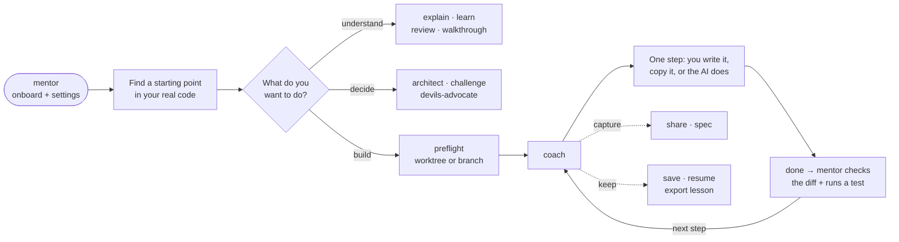

# Dev Mentor

**Build features you understand. Learn where to start next time.**

Dev Mentor is a set of skills for your AI coding assistant. It helps you find your way around a codebase, plan a feature, build it one step at a time, and check your work. It adapts to you, whether you're vibe coding your first app or you're a principal engineer reviewing a design.

## What it looks like

```text
You:     Use mentor. Help me add a "remember me" option to login. I'll write the code.

Mentor:  I'll pitch this for a junior dev, balanced tone, one step at a time,
         and ask who does each edit. Say `settings` to change.

         **Remember me · orientation**
         The ticket asks for sessions that survive closing the browser (today
         they end on close). Login flows through:

           LoginForm.tsx → POST /api/login → auth/session.ts (createSession)
                                                    ▲ start here

         Open `auth/session.ts` and look at how `createSession` sets the cookie.
         Nothing to edit yet.

You:     next

Mentor:  **Remember me · the cookie today**
         `createSession` sets `maxAge` to undefined, so the browser treats the
         cookie as a session cookie and deletes it on close…

You:     done

Mentor:  **Works ✓**
         Your diff passes `remember` through and sets `maxAge` only when it's
         true. `npm test auth` passes (12 tests). Next: the checkbox in LoginForm.
```

## Make it yours

On first use, `mentor` asks a few quick setup questions (about a minute). If your assistant has a clickable picker (e.g. Claude Code or Cursor), it uses that; otherwise you get one text card you answer like `d 3 a a off`. Or just say `defaults`. You can change any setting mid-lesson, or just for one task.

| Setting | Options | Say |
| --- | --- | --- |
| **Experience** | brand new · vibe coder · junior · mid-level · senior · lead or principal | `simpler`, `more technical`, `set level lead` |
| **Tone** | 1 blunt · 2 direct · 3 balanced · 4 warm · 5 extra warm | `warmer`, `more direct` |
| **Pace** | one step, then wait · a few steps · the whole thing | `slower`, `faster` |
| **Build** | choose each time · I write, AI guides · AI shows, I copy · AI writes, explains | `you do this one`, `you write the tests` |
| **Output** | write code · Markdown spec · OpenSpec change | `build spec`, `change output` |
| **ADHD mode** | off · on | `ADHD mode on`, `ADHD mode off` |
| **Debate models** | the three models `devils-advocate` uses, plus a reasoning effort | `set up debate models` |
| **Export** | where lesson notes go: Notion · Obsidian · Markdown folder | `export lesson` asks the first time |

**Build** always starts by showing you where to start and why, so you learn the route even when the AI writes the code. With the default, *ask me each step*, you choose per edit: write it yourself, copy an explained snippet, let the AI do it (handy for tests or boilerplate), or turn it into a spec or OpenSpec change.

**ADHD mode** is off by default. Turn it on and every reply starts with the one thing to do, shows where you are (`Step 3 of 5`), gives a time estimate (`~2 min`), ticks off finished steps, and parks side topics until you're ready. It changes how replies are shaped, not what they say.

**Changing them later:**

| Say | What happens |
| --- | --- |
| `settings` | Shows your current choices, then asks what to change: everything, or just one area. |
| `change tone` (or `experience`, `pace`, `build`, `output`, `ADHD mode`) | Asks just that one question again. |
| `change everything` | Runs the full setup again. |
| `warmer`, `faster`, `ADHD mode on`… | Changes it straight away, no questions. |
| `you do this one` | For this step only; your settings stay the same. |
| `reset settings` | Back to defaults, or run setup again. |

If you saved a profile, changes are saved automatically to the same place and the AI tells you in one line. Then it shows the step you were on again, in your new settings, so you carry on from where you left off.

Tone changes how things are said, never the truth: problems are always stated plainly.

**Where settings live:** for all your projects in `~/.dev-mentor/profile.md` (the default), or for one project in `.dev-mentor/profile.md`, which overrides only the lines it contains.

## The flow



## Skills

| Skill | Helps you |
| --- | --- |
| [mentor-style](skills/mentor-style/SKILL.md) | Loaded automatically: the settings and ground rules every other skill follows, including the project preflight that puts code-changing lessons on their own worktree or branch. You never need to call it. |
| [mentor](skills/mentor/SKILL.md) | Start here: setup and settings, where to start in your code, save and resume several lessons, export them to Notion or Obsidian, and watch a PR's comments and CI. |
| [coach](skills/coach/SKILL.md) | Build a feature step by step, on a new worktree or branch you name (such as the ticket key). Each edit, you write it, copy an explained snippet, or let the AI do it, and your work gets checked. |
| [explain](skills/explain/SKILL.md) | Understand how existing code runs. |
| [learn](skills/learn/SKILL.md) | Learn a concept or technology. |
| [review](skills/review/SKILL.md) | Understand a colleague's PR so you can review it. |
| [walkthrough](skills/walkthrough/SKILL.md) | Tour changes that are already finished. |
| [architect](skills/architect/SKILL.md) | Compare designs and trade-offs. For "how should we store or build X?", it proposes a concrete design (such as a table's keys and indexes) and walks each of your queries through it. |
| [challenge](skills/challenge/SKILL.md) | Check a recommendation before you act on it: how it was reached, whether it matches your code's style, and what it skipped. Brings in devils-advocate when the case looks weak. |
| [devils-advocate](skills/devils-advocate/SKILL.md) | Poke holes in a proposal with a debate between the models your assistant can really run (three if it can, two if not), or a quick single-model challenge. Every reviewer gets the same context first (the repo plus any diagrams or docs you add), and design questions get the smallest design that fits, which every reviewer votes on. |
| [share](skills/share/SKILL.md) | Share a plan for a colleague or senior dev to review before you build, a lesson as a note for Notion or Obsidian, or a debate or review outcome as an ADR for the team. Sends as an HTML file (password optional), as Markdown, or in a tool you already use. |
| [spec](skills/spec/SKILL.md) | Turn a plan into a spec (Markdown, Matt Pocock or pstack style, or OpenSpec), written on its own worktree or branch. |

Install them all: every skill loads `mentor-style` for your settings, and hands saved lessons and exports over to `mentor`. Each skill has a short [guide](docs/skills/README.md) with what it does, when to use it, and how to tell it's working.

## Install

**Any skill-capable assistant** (Cursor, Claude Code, Codex, OpenCode and more). Run this in your project:

```sh
npx skills add SirL0fty/dev-mentor
```

Pick your assistant and choose **global** to use it in every project. This needs Node.js 22.20 or newer.

<a id="install-claude"></a>
**Claude Code plugin:**

```sh
claude plugin marketplace add SirL0fty/dev-mentor
claude plugin install dev-mentor@dev-mentor
```

Then run `/dev-mentor:mentor`.

<a id="install-chatgpt"></a>
**ChatGPT desktop / Codex:** go to **Plugins → Add plugin marketplace**, enter `SirL0fty/dev-mentor` with Git ref `main`, then install **Dev Mentor**. Select it with `@` in a new chat.

<a id="install-cursor"></a>
**Cursor:** go to **Customize → From GitHub Repository**, paste `https://github.com/SirL0fty/dev-mentor`, then install Dev Mentor.

<a id="install-opencode"></a><a id="install-other"></a>
**OpenCode and others:** use the `npx` command above.

[Detailed install, update and troubleshooting](docs/plugins.md) · [Host compatibility](docs/compatibility.md)

## Get started

```text
Use mentor to help me get started.
```

Or give it a ticket: **"Help me build this one step at a time. I'll write the code."**

### Things you can say

| During a lesson | |
| --- | --- |
| `done` | Check my edit (it reads your diff and runs a quick test). |
| `next` / `back` | Move between steps. |
| `why` · `example` · `more detail` · `help` | Ask about this step without moving on. |
| `you do this one` | The AI makes this edit. |
| `is this right?` · `challenge this` | Check the last recommendation against your code, and bring in a devil's advocate if it looks weak. |

| Lessons | |
| --- | --- |
| `save` | Save this lesson. Each one gets its own file in `.dev-mentor/lessons/`, so you can have several. |
| `resume` | Pick one back up; asks which if you have several. `resume pagination` goes straight there. |
| `lessons` | List your saved lessons with where you got to. |
| `export lesson` | Turn a lesson into a learning note in **Notion**, **Obsidian** or a Markdown folder. `export all lessons` does them all. |
| `delete lesson <name>` | Remove one (asks first). |

If what you ask about isn't in the project, it tells you which project it looked in and asks whether to build it as a new feature, switch project, or point it to the right file.

## Update

`npx skills update` (add `-g` for a global install). For plugins, see the [update guide](docs/plugins.md#updates). See the [changelog](CHANGELOG.md) for what changed.

## Contributing

Found a skill doing the wrong thing? [Open an issue](https://github.com/SirL0fty/dev-mentor/issues/new?template=skill-misbehaved.md) with the transcript. Want to change a skill? See [CONTRIBUTING.md](CONTRIBUTING.md) and the [skill guides](docs/skills/README.md).

Inspired by [pstack](https://github.com/cursor/plugins/tree/main/pstack).

[MIT licence](LICENSE) · By [SirL0fty](https://github.com/SirL0fty)
