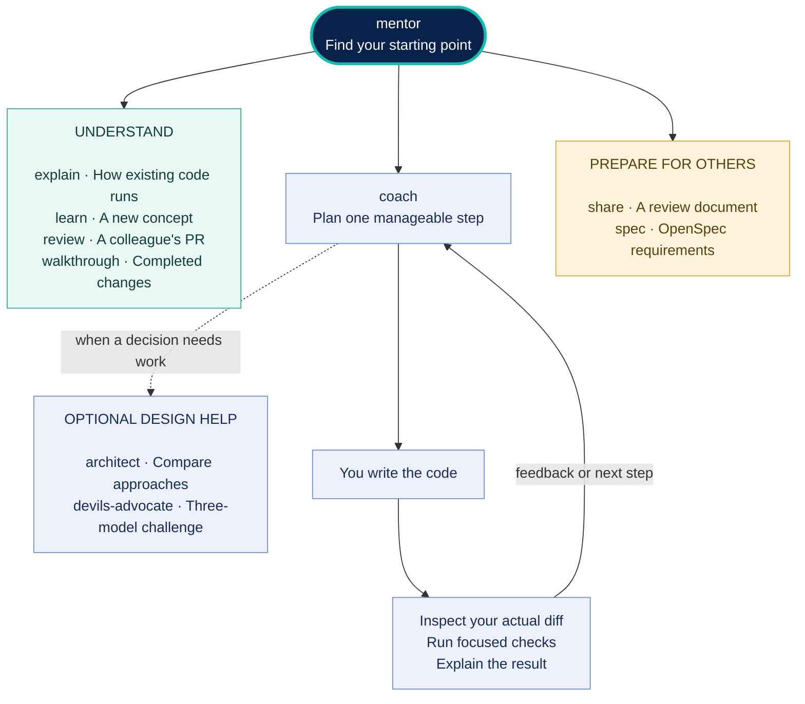

# Dev Mentor

**Build features you understand. Learn where to start next time.**

Dev Mentor helps you work through a feature in your own codebase: find the entry point, follow the runtime, choose a small change, and check the result. You write the code while your assistant guides you through the decisions.

The goal is independence. Start with a demonstration, try the next step with hints, then tackle a similar problem yourself.

Ten skills, one place to start: **mentor**. By [SirL0fty](https://github.com/SirL0fty).

[Help](#help) · [Install](#install) · [Get started](#get-started) · [Skill map](#skill-map) · [Watch a PR](#watch-a-pr) · [Skills](#skills) · [Update](#update)

## Help

After installing, open the project you want to work on. In **ChatGPT or Codex desktop**, type **`@`**, search for **Dev Mentor**, select the plugin, and send **`help`**. Select the actual plugin suggestion so it is attached to your message. You do not need to find all ten skills in the `/` list.

In **Claude Code**, use `/dev-mentor:mentor help`. In **Cursor or OpenCode**, ask:

```text
Use the mentor skill from Dev Mentor.
Help me find something to work on in this codebase.
```

The mentor inspects your code and offers **up to three concrete prompts** tied to real files, functions, or tests, with a recommended starting point. Pick one to begin. Hosts that read skill display metadata show names such as **Dev Mentor: Coach**; the underlying skill names stay the same.

Already in a lesson? Say **help** for a hint without losing your place. Ask **“What else could I work on?”** for other ideas, or **“Help commands”** for the controls.

## Install

Choose your assistant below. Each guide covers installation, starting a session, and checking that Dev Mentor is available. Install either the native plugin or the standalone skills in a given assistant to avoid duplicate entries.

| Where you work | Installation route |
| --- | --- |
| [ChatGPT desktop / Codex](#install-chatgpt) | Add the GitHub marketplace and install Dev Mentor. |
| [Cursor](#install-cursor) | Import the GitHub marketplace in Customize, or use the skills CLI. |
| [Claude Code](#install-claude) | Add the marketplace, then install the namespaced plugin. |
| [OpenCode](#install-opencode) | Install the same ten workflows as Agent Skills. |
| [Other assistants](#install-other) | Select the assistant used by your editor in the skills CLI. |

**Before you begin:** have your coding assistant installed and signed in. Commands beginning with `npx` also require Node.js 22.20 or newer; check with `node --version`. Open a local project when you want the mentor to inspect its code.

<a id="install-chatgpt"></a>
<details>
<summary><strong>ChatGPT desktop and Codex — add the GitHub marketplace</strong></summary>

**In the desktop app**

1. Open **Plugins**, then choose **Add plugin marketplace**.
2. Fill in the dialog using the values below.
3. Click **Add marketplace**.
4. Select the **Dev Mentor** marketplace in the plugin browser.
5. Open **Dev Mentor** by **SirL0fty** and install it.
6. Start a new chat with the plugin enabled. Use **Work or Codex with your project open** for codebase coaching.

| Field | Enter |
| --- | --- |
| Source | `SirL0fty/dev-mentor` |
| Git ref | `main` |
| Sparse paths | Leave blank |

Leave Sparse paths empty so the whole package is available. If the marketplace does not appear, restart the app and reopen Plugins.

**Start using it**

Type `@`, search **Dev Mentor**, select the plugin, and send `help`. You can also choose one of the starter prompts on the plugin's detail page. The mentor chooses the workflow for your request. See [OpenAI's plugin usage guide](https://learn.chatgpt.com/docs/plugins).

**On another machine**

Repeat the marketplace setup there. Dev Mentor is hosted in this GitHub repository and has not been submitted to the public plugin directory, so searching the public catalog alone will not find it.

**Terminal alternative**

If you use Codex CLI, register the source with:

```sh
codex plugin marketplace add SirL0fty/dev-mentor --ref main
```

Then open the plugin browser in the desktop app, or run `/plugins` inside Codex CLI, select the Dev Mentor marketplace, and install the plugin. Start a fresh session after installation.

**Check:** the plugin detail page should show **SirL0fty**, version **0.6.2** or newer, and **10 skills**. Adding a marketplace makes the plugin discoverable; installing it is a separate step. See [OpenAI's marketplace guide](https://developers.openai.com/plugins/build/plugins#add-a-marketplace-from-the-cli).

</details>

<a id="install-cursor"></a>
<details>
<summary><strong>Cursor — import the repository in Customize</strong></summary>

**Native plugin**

1. Open your project in Cursor, then open **Customize**.
2. Choose **From GitHub Repository**.
3. Paste `https://github.com/SirL0fty/dev-mentor` and complete the import.
4. Find **Dev Mentor** in the imported marketplace and install it.
5. Start a new Agent chat in your project.
6. Ask **“Use the mentor skill from Dev Mentor. Help me find where to start.”**

**Check:** Dev Mentor's skills should appear in Customize. In Agent chat, type `/mentor` to filter the skill list, then select the Dev Mentor skill. Start with that one entry; it routes to the other workflows. See [Cursor's repository installation guide](https://cursor.com/docs/skills#installing-skills-from-a-repository).

**If repository import is unavailable**

From your project's terminal, install the standalone skills:

```sh
npx skills add SirL0fty/dev-mentor --agent cursor --skill '*'
```

Follow the installer prompts, reopen the project or start a new Agent chat, and use the same mentor prompt.

**Teams:** an administrator can use **Dashboard → Plugins & MCPs → Add Marketplace → Import from Repo**, paste the repository URL, and make Dev Mentor available to the team. See [Cursor's team marketplace guide](https://cursor.com/docs/plugins#add-a-team-marketplace).

</details>

<a id="install-claude"></a>
<details>
<summary><strong>Claude Code — install the namespaced plugin</strong></summary>

**From your terminal**

1. Open a terminal in your project.
2. Register Dev Mentor's marketplace, then install the plugin:

```sh
claude plugin marketplace add SirL0fty/dev-mentor
claude plugin install dev-mentor@dev-mentor
```

3. Start a new Claude Code session.
4. Enter:

```text
/dev-mentor:mentor help
```

The default installation scope is your user account on that machine. To enable it for only this repository without changing shared project settings, use `--scope local` on the install command.

**From an existing Claude Code session**

```text
/plugin marketplace add SirL0fty/dev-mentor
/plugin install dev-mentor@dev-mentor
```

Choose the scope offered by the installer. Start a new session or use `/reload-plugins`, then invoke `/dev-mentor:mentor help`.

**Check:** open the Installed tab in `/plugin`, or run `claude plugin list` in your terminal. Typing `/dev-mentor:` filters the skills to this plugin's namespace; for example, `/dev-mentor:walkthrough` starts a guided tour.

These instructions are for Claude Code, including its supported local desktop and IDE surfaces. See [Claude Code's installation guide](https://code.claude.com/docs/en/discover-plugins) for current scope and refresh behaviour.

</details>

<a id="install-opencode"></a>
<details>
<summary><strong>OpenCode — install the ten Agent Skills</strong></summary>

OpenCode loads Dev Mentor through its Agent Skills support. You do not need to add Dev Mentor to OpenCode's JavaScript plugin configuration.

1. Open a terminal in the project you want to work on.
2. Install the skills:

```sh
npx skills add SirL0fty/dev-mentor --agent opencode --skill '*'
```

3. Follow the prompts to install into the current project. Choose **Copy** if you prefer ordinary files instead of symlinks.
4. Start a new OpenCode session in that project.
5. Ask:

```text
Use the mentor skill from Dev Mentor.
Help me find where to start in this codebase.
```

**For every project on this machine**, use a global installation instead of the project command:

```sh
npx skills add SirL0fty/dev-mentor --agent opencode --skill '*' --global
```

**Check:** ask OpenCode to load the `mentor` skill. It should have access to all ten workflows. If it cannot find the skill, check the destination printed by the installer and your skill permissions. OpenCode discovers project and global skill directories, including `.agents/skills`; see its [discovery and troubleshooting guide](https://opencode.ai/docs/skills/).

</details>

<a id="install-other"></a>
<details>
<summary><strong>Other assistants — use the skills CLI</strong></summary>

From your project, run:

```sh
npx skills add SirL0fty/dev-mentor
```

Choose your assistant, the skills to install, and project or global scope. You can select multiple assistant targets explicitly:

```sh
npx skills add SirL0fty/dev-mentor --skill '*' --agent cursor claude-code codex opencode
```

For T3 Code or OpenChamber, select the provider used inside the app. For VS Code, select your assistant extension, such as Codex or GitHub Copilot. Start a new assistant session and ask it to use Dev Mentor's `mentor` skill.

The standard installer places instructions in the selected host's skill directories. It does not add a custom agent, model subscription, or background service. See [host compatibility](docs/compatibility.md) for checked paths and remaining limits.

</details>

## Get started

Already have a feature in mind? Ask:

```text
Use mentor to help me add pagination to this search endpoint.
I don't know where to start, and I want to make the changes myself.
```

`mentor` chooses the workflow and keeps your place as you work. Start with your ticket, a question, or a change you want to understand.

A feature lesson follows this path:

```text
Find the entry point → Trace the runtime → Make a small change → Verify it
```

You learn why each step comes next, how to find the relevant code, and what evidence shows the change works.

## Skill map

Start with **mentor**. It routes your request; you can also name any skill directly. The side paths are optional—you do not need to complete every workflow to build a feature.



The panels group related skills. The loop is the normal coaching path; the dotted branch is optional design help. A review document or specification does not approve implementation. **PR watching** is another mode of `mentor`: it brings new comments or CI failures into the same coaching loop when the host can monitor them.

## One step at a time

Lessons arrive as small cards: one idea or action, a short reason, and a next step. For example:

> **Find the entry point**
>
> Start with the endpoint path in your ticket. Its route registration tells you which handler receives the request.
>
> **Your next step:** Find that registration and share the handler it points to.

After you edit, say **done**. The mentor inspects your actual change, runs relevant checks when available, and gives focused feedback. A missing piece stays in focus before you move on.

| Say | What happens |
| --- | --- |
| `help` | Get a hint for the current step, or codebase-specific starting ideas when no task is selected. |
| `next` / `back` | Move one card. A pending edit is checked before advancing. |
| `why` / `example` | Explore the current point without losing your place. |
| `smaller` / `more detail` | Adjust the size or depth of the current explanation. |
| `map` | See the flow and where you are in it. |

Ask for the full explanation whenever you want it. To continue another day, ask the mentor to save your progress and resume from that checkpoint.

## Watch a PR

```text
Use mentor. Watch this PR's comments and CI: [PR link].
Tell me when something needs attention and coach me through fixing it.
```

The watch checks new comments and CI for the latest commit, stays quiet when nothing needs attention, and explains one issue at a time. You make the changes; the mentor checks your edits and follows the resulting CI run once the fix is pushed.

Watching uses your assistant's available scheduler or a bounded live session. It confirms which is running and when it stops; background monitoring is not available in every host. Watching alone does not post replies, push code, rerun CI, or merge. Say **stop watching** to end it.

This is a mode of **mentor**. Use **review** when you want to understand a colleague's PR so you can review their changes.

## Skills

Use **mentor** as your starting point, or name a skill directly.

<details>
<summary>Explore all ten skills</summary>

| Skill | Reach for it when… |
| --- | --- |
| [mentor](skills/mentor/SKILL.md) | You want help getting started, resuming a lesson, or watching a PR's comments and CI. |
| [explain](skills/explain/SKILL.md) | You want to understand how existing code runs. |
| [coach](skills/coach/SKILL.md) | You're building a feature and want guidance while you implement it. |
| [learn](skills/learn/SKILL.md) | You're studying a concept, technology, or certification topic. |
| [review](skills/review/SKILL.md) | You want to understand a colleague's PR so you can review their changes. |
| [architect](skills/architect/SKILL.md) | You need to compare approaches and understand the trade-offs. |
| [devils-advocate](skills/devils-advocate/SKILL.md) | You want three different models to challenge a proposal. |
| [walkthrough](skills/walkthrough/SKILL.md) | You want a guided tour of completed changes. |
| [share](skills/share/SKILL.md) | You want a plan or lesson prepared for a colleague's review. |
| [spec](skills/spec/SKILL.md) | You want an agreed feature plan converted into an OpenSpec change. |

</details>

### Try these prompts

**Prepare to review a colleague's PR**

```text
Use review to help me understand my colleague's PR: [PR link].
Explain what changes at runtime, what I should check, and which questions
are worth asking the author. One small step at a time.
```

**Understand the runtime**

```text
Use explain to trace a request from this API handler to the database
and back. Follow one example input, one step at a time.
```

**Explain your work to a colleague**

```text
Use walkthrough to guide me through this PR.
Help me explain what changed, why, and how it's tested.
```

**Get a plan ready for review**

```text
Use share to prepare our current plan for my senior.
Include the open decisions and specific questions for them.
```

### Challenge a decision with three models

```text
Use devils-advocate to challenge this design with three different models.
Work toward an agreed decision and explain the reasons behind it.
```

The models assess the same evidence independently, challenge each other's conclusions, and ratify the same decision and rationale. The result includes rejected alternatives, accepted trade-offs, and remaining checks.

Your assistant needs access to three distinct models. If a participant is unavailable or the debate remains unresolved, that stays explicit. Agreement is a recommendation; you decide whether to implement it.

## Update

For skills CLI installations:

```sh
npx skills update
```

Native plugin users can follow the [plugin update steps](docs/plugins.md#updates).

## License

[MIT](https://github.com/SirL0fty/dev-mentor/blob/main/LICENSE).
