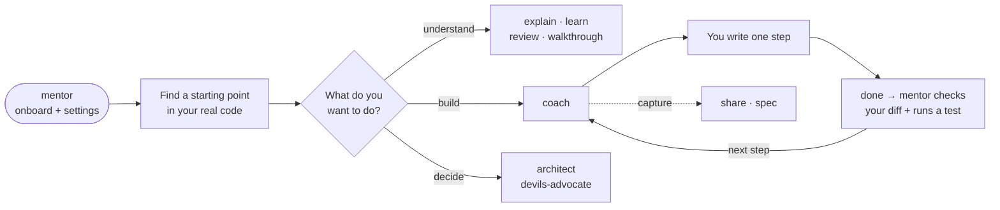

# Dev Mentor

**Build features you understand. Learn where to start next time.**

Dev Mentor is a set of skills for your AI coding assistant. It helps you find your way around a codebase, plan a feature, build it one step at a time, and check your work. It adapts to you, whether you're vibe coding your first app or you're a principal engineer reviewing a design.

## What it looks like

```text
You:     Use mentor. Help me add a "remember me" option to login. I'll write the code.

Mentor:  I'll pitch this for someone growing, balanced tone, you write the code.
         Say `settings` to change.

         **Remember me · orientation**
         The ticket asks for sessions that survive closing the browser (today
         they end on close). Login flows through:

           LoginForm.tsx → POST /api/login → auth/session.ts (createSession)
                                                    ▲ start here

         Open `auth/session.ts` and look at how `createSession` sets the cookie.
         Nothing to edit yet.

You:     next

Mentor:  **Remember me · the cookie today**
         `createSession` sets `maxAge` to undefined, so the browser treats the
         cookie as a session cookie and deletes it on close…

You:     done

Mentor:  **Works ✓**
         Your diff passes `remember` through and sets `maxAge` only when it's
         true. `npm test auth` passes (12 tests). Next: the checkbox in LoginForm.
```

## Make it yours

On first use, `mentor` asks four quick questions (or you just say `defaults`). You can change any setting mid-lesson by saying so.

| Setting | Options | Say |
| --- | --- | --- |
| **Level** | new to coding / vibe coder · growing · experienced · lead or principal | `simpler`, `more technical`, `set level lead` |
| **Warmth** | 1 blunt · 2 direct · 3 balanced · 4 warm · 5 extra warm | `warmer`, `more direct` |
| **Pace** | one step at a time · a few steps · everything at once | `slower`, `faster` |
| **Hands** | I write the code · we share it · you write it and explain | `you write this one` |
| **ADHD mode** | off · on | `ADHD mode on`, `ADHD mode off` |
| **Debate models** | the three models `devils-advocate` uses, plus a reasoning effort | `set up debate models` |

**ADHD mode** is off by default. Turn it on and every reply starts with the one thing to do, shows where you are (`Step 3 of 5`), gives a time estimate (`~2 min`), ticks off finished steps, and parks side topics until you're ready. It changes how replies are shaped, not what they say.

Warmth changes the tone, never the truth: problems are always stated plainly. Say `settings` to see your current choices. Mentor can save them to `.dev-mentor/profile.md` so it remembers next time.

## The flow



## Skills

| Skill | Helps you |
| --- | --- |
| [mentor](skills/mentor/SKILL.md) | Get started, change settings, find where to start, resume a lesson, or watch a PR's comments and CI. |
| [coach](skills/coach/SKILL.md) | Build a feature step by step while you write the code. |
| [explain](skills/explain/SKILL.md) | Understand how existing code runs. |
| [learn](skills/learn/SKILL.md) | Learn a concept or technology. |
| [review](skills/review/SKILL.md) | Understand a colleague's PR so you can review it. |
| [walkthrough](skills/walkthrough/SKILL.md) | Tour changes that are already finished. |
| [architect](skills/architect/SKILL.md) | Compare designs and trade-offs. |
| [devils-advocate](skills/devils-advocate/SKILL.md) | Poke holes in a proposal, or run a three-model debate. |
| [share](skills/share/SKILL.md) | Write up a plan for a colleague to review. |
| [spec](skills/spec/SKILL.md) | Turn a plan into a spec (Markdown, Matt Pocock or pstack style, or OpenSpec). |

Each skill is a single, self-contained `SKILL.md`, so you can install all of them or only the ones you want.

## Install

**Any skill-capable assistant** (Cursor, Claude Code, Codex, OpenCode and more). Run this in your project:

```sh
npx skills add SirL0fty/dev-mentor
```

Pick your assistant and choose **global** to use it in every project. This needs Node.js 22.20 or newer.

<a id="install-claude"></a>
**Claude Code plugin:**

```sh
claude plugin marketplace add SirL0fty/dev-mentor
claude plugin install dev-mentor@dev-mentor
```

Then run `/dev-mentor:mentor`.

<a id="install-chatgpt"></a>
**ChatGPT desktop / Codex:** go to **Plugins → Add plugin marketplace**, enter `SirL0fty/dev-mentor` with Git ref `main`, then install **Dev Mentor**. Select it with `@` in a new chat.

<a id="install-cursor"></a>
**Cursor:** go to **Customize → From GitHub Repository**, paste `https://github.com/SirL0fty/dev-mentor`, then install Dev Mentor.

<a id="install-opencode"></a><a id="install-other"></a>
**OpenCode and others:** use the `npx` command above.

[Detailed install, update and troubleshooting](docs/plugins.md) · [Host compatibility](docs/compatibility.md)

## Get started

```text
Use mentor to help me get started.
```

Or give it a ticket: **"Help me build this one step at a time. I'll write the code."**

As you go, say **done**, **next**, **back**, **why**, **example**, **help** or **save**. Next time, say **resume** to pick up where you left off.

## Update

`npx skills update` (add `-g` for a global install). For plugins, see the [update guide](docs/plugins.md#updates). See the [changelog](CHANGELOG.md) for what changed.

## Contributing

Found a skill doing the wrong thing? [Open an issue](https://github.com/SirL0fty/dev-mentor/issues/new?template=skill-misbehaved.md) with the transcript. Want to change a skill? See [CONTRIBUTING.md](CONTRIBUTING.md) and the [behaviour checks](evals/README.md).

Inspired by [pstack](https://github.com/cursor/plugins/tree/main/pstack).

[MIT licence](LICENSE) · By [SirL0fty](https://github.com/SirL0fty)
