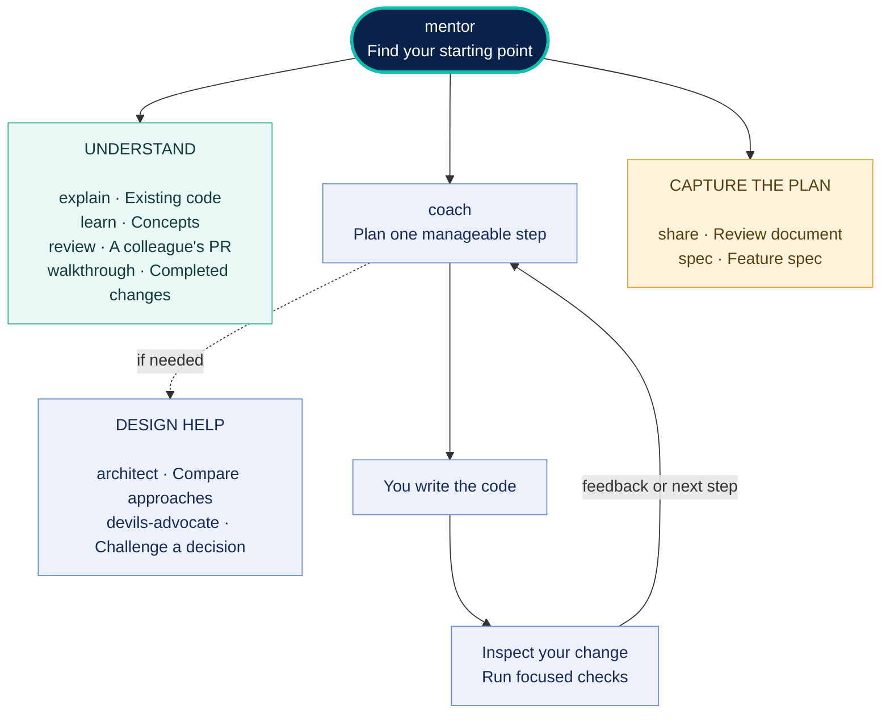

# Dev Mentor

**Build features you understand. Learn where to start next time.**

Dev Mentor helps you find your way around a codebase, plan a feature, make changes one step at a time, and check your work. Start with **mentor**; it guides you to the right skill.

## Skills

| Skill | What it helps you do |
| --- | --- |
| [mentor](skills/mentor/SKILL.md) | Find where to start, resume a lesson, or watch a PR's comments and CI. |
| [explain](skills/explain/SKILL.md) | Understand how existing code runs. |
| [coach](skills/coach/SKILL.md) | Build a feature with guidance while you write the code. |
| [learn](skills/learn/SKILL.md) | Learn a concept or technology. |
| [review](skills/review/SKILL.md) | Understand a colleague's PR so you can review it. |
| [architect](skills/architect/SKILL.md) | Compare designs and trade-offs. |
| [devils-advocate](skills/devils-advocate/SKILL.md) | Challenge a proposal with three distinct models. |
| [walkthrough](skills/walkthrough/SKILL.md) | Take a guided tour of completed changes. |
| [share](skills/share/SKILL.md) | Prepare a plan or lesson for a colleague to review. |
| [spec](skills/spec/SKILL.md) | Turn a plan into a feature spec or an OpenSpec change. |

## Install

**For Cursor, OpenCode, Codex, and other skill-capable assistants**, open a terminal in your project and run:

```sh
npx skills add SirL0fty/dev-mentor
```

Choose your assistant and the skills you want. Choose **global** to use them across projects on that machine. `npx` requires Node.js 22.20 or newer. For T3 Code or OpenChamber, select the assistant provider used by the app.

Prefer a native plugin? Choose your assistant:

<a id="install-chatgpt"></a>
**ChatGPT desktop / Codex:** Open **Plugins → Add plugin marketplace**. Enter `SirL0fty/dev-mentor` as the source, `main` as the Git ref, and leave sparse paths blank. Add the marketplace, then install **Dev Mentor** by SirL0fty. Start a new chat.

<a id="install-cursor"></a>
**Cursor:** Open **Customize → From GitHub Repository**, enter `https://github.com/SirL0fty/dev-mentor`, then install Dev Mentor from the imported marketplace.

<a id="install-claude"></a>
**Claude Code:**

```sh
claude plugin marketplace add SirL0fty/dev-mentor
claude plugin install dev-mentor@dev-mentor
```

<a id="install-opencode"></a><a id="install-other"></a>
**OpenCode and other assistants:** Use the `npx` command above and select your assistant. Start a new session after installation.

[Detailed installation, updates and troubleshooting](docs/plugins.md) · [Host compatibility](docs/compatibility.md)

## Get started

Open your project and ask:

```text
Use mentor to help me find where to start in this codebase.
```

Or give it a ticket or feature: **“Help me build this one step at a time. I'll write the code.”** In ChatGPT/Codex desktop, select **Dev Mentor** with `@` first. In Claude Code, use `/dev-mentor:mentor help`.

The mentor explains the goal and current code, shows where to start, and guides you through small steps. After an edit, say **done** so it can inspect your change and run relevant checks. Say **help**, **next**, **back**, **why**, **example**, or **more detail** as you go.

<a id="help"></a><a id="create-a-spec"></a><a id="watch-a-pr"></a>
You can also ask it to **walk through a PR**, **prepare a plan for review**, **turn a plan into a spec**, or **watch a PR's comments and CI**. Watching needs a host that supports monitoring. OpenSpec conversion needs the project's OpenSpec setup and the official `openspec-propose` skill. The three-model debate needs access to three distinct models.

## Skill map



## Update

For skills installed with `npx`, run `npx skills update` in your project. If you installed globally, use `npx skills update -g`. See the [update guide](docs/plugins.md#updates) for native plugins.

[MIT licence](https://github.com/SirL0fty/dev-mentor/blob/main/LICENSE) · By [SirL0fty](https://github.com/SirL0fty)
